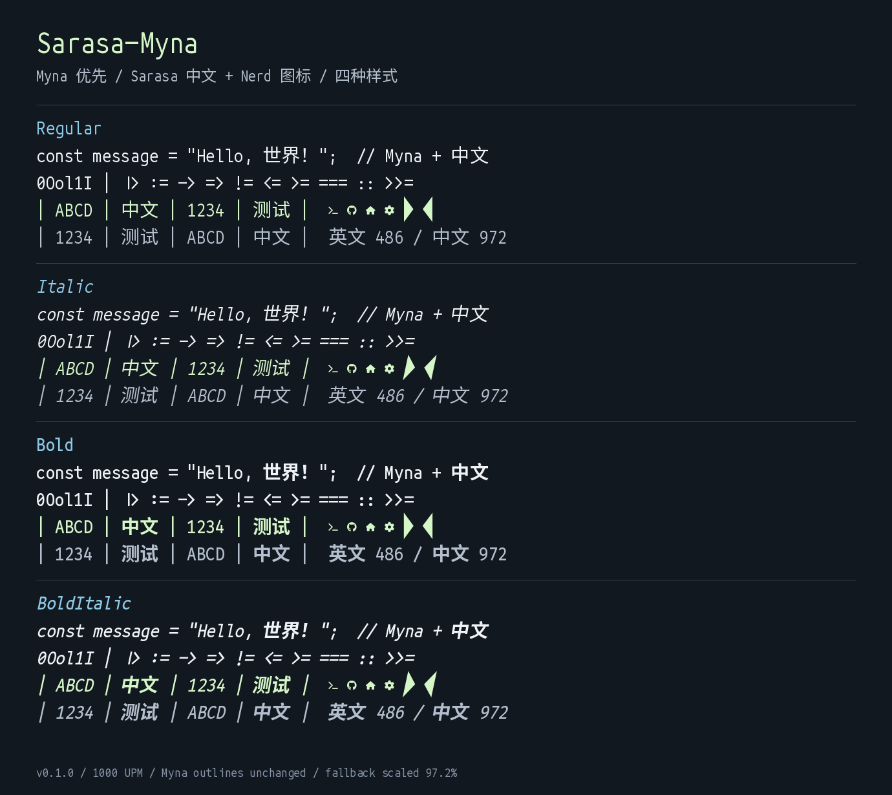

# Sarasa-Myna

**Myna 字符优先，Sarasa Term SC Nerd 补齐中文和其他字符。**

独立派生字体，不是上游项目的官方版本，也不代表上游作者背书。

## 下载与安装

前往本仓库 **Releases** 下载 `Sarasa-Myna-v0.1.0.zip`，解压并安装 `fonts/` 中的四个 TTF：

- `Sarasa-Myna-Regular.ttf`
- `Sarasa-Myna-Italic.ttf`
- `Sarasa-Myna-Bold.ttf`
- `Sarasa-Myna-BoldItalic.ttf`

macOS：双击字体，在「字体册」中安装。Windows：选中 TTF，右键安装。Linux：复制到 `~/.local/share/fonts/`，运行 `fc-cache -f`。

在终端或编辑器中选择字体族 **Sarasa-Myna**。只安装这四个文件即可，不需要同时安装上游字体。构建和测试不会自动安装或更改系统字体设置。



## 字形来源与布局

- 对于每个样式，只要 Myna 的 Unicode cmap 中有该字符，就使用 Myna 的原始轮廓和水平指标，包括英文、数字、符号和其覆盖的其他文字。
- Myna 没有的字符取自对应字重/斜体的 Sarasa Term SC Nerd；并非只补中文。
- Myna 保持 1000 UPM、半宽 486 不变。Sarasa 轮廓、定位和间距统一缩放到原来的 **97.2%**：半宽 486，全宽 972，中英严格 **2:1**。
- 所有样式共用默认行距：ascender 984、descender -277、line gap 0。Windows 防裁切边界覆盖全部字形。某些软件若忽略 `USE_TYPO_METRICS` 而使用 Windows 指标，行距可能偏大；可以在应用里调整行距。
- 正文使用 Myna 原有上下文替换功能（`calt`、`ccmp`、`frac`），并保留其 GPOS 定位以及 Sarasa 的可用 GPOS。Myna 的设计主要依靠单字符形状自然衔接，不是凭空增加大量编程连字。
- 斜体轮廓来自上游 Myna 斜体；修正了其倾斜角度和光标倾斜元数据的方向，未改动原始轮廓。
- 重新计算了上游部分相差 1 个字体单位的字形边界框。轮廓坐标和水平指标保持不变，但极大字号下的实际放置可能有 1/1000 em 级差异，不声称逐像素完全相同。
- 只有上游共同提供的 Regular、Italic、Bold、Bold Italic 四个样式。不会将 Regular 冒充 Light 或把 Bold 冒充其他字重。

## 已知范围与限制

1. **公开版排除了 U+E200–U+E2A9 的 170 个 Font Awesome Extension 私用区图标。** Nerd Fonts v3.3.0 的许可审计称其为 MIT，但该图标集上游仓库没有独立许可文件，字体也没有许可证元数据。为避免将未经独立核实的许可当作已确认许可，本版不分发这些字形。其他 Nerd 图标按源字体覆盖保留。Font Logos 的 Unlicense 是有效的公有领域许可，不是「无许可证」，所以没有排除 Font Logos。
2. **Sarasa 上游 v2.3.1 的 Unhinted Regular/Bold GSUB 表存在无法解析的数据。** FontTools 报告 `unknown format: 2304`。为生成可完整解码且样式行为一致的字体，本版不保留任何样式的 Sarasa GSUB。Myna 的 GSUB 保留。中文常用字形和图标仍在，但 Sarasa 特有的替代字形、纵排替换和依赖 GSUB 的复杂文字塑形不保证可用。
3. 不承诺覆盖全部 Unicode。Regular/Italic 为 **59,717** 个编码字符；Bold/BoldItalic 为 **59,716** 个。差异来自 Myna 上游各样式的 cmap，并非人工丢失字符。
4. 字符宽度是字体层面的 2:1；终端如何解释 Emoji、组合字符和 Unicode 宽度仍取决于应用自己的规则。
5. 使用 Unhinted Sarasa 源字体，适合现代抗锯齿渲染。没有生成重新 hint 的版本。部分极高/极低组合符号会超出默认行框，可能需要较大行距。
6. Nerd Powerline 图标按与其他补充字形相同的 97.2% 比例缩放，没有针对每个终端的背景条行高重新拉伸。若主题给终端增加行距，仍可能出现细缝。

## 可复现构建

测试环境：CPython 3.12、FontTools 4.61.1、uharfbuzz 0.52.0、Pillow 13.0.0。

```sh
python3 -m venv .venv
. .venv/bin/activate
python -m pip install -r requirements.txt
python scripts/fetch_sources.py
python scripts/build.py
python scripts/check_reproducibility.py
python scripts/validate.py
```

`fetch_sources.py` 只从官方 GitHub 发布下载固定版本，对整个下载包校验 SHA-256，且只提取预期文件。源文件、临时构建和虚拟环境不进入 Git。

固定来源：

| 来源 | 版本 | 发布包 SHA-256 |
| --- | --- | --- |
| [Myna](https://github.com/sayyadirfanali/Myna/releases/tag/v2.0.0.0-beta) | v2.0.0.0-beta | `0013ff1c868356f4dbcb9a58799a779b3c86cf2e545eafd71e3f32c38fcf8a7b` |
| [Sarasa Term SC Nerd](https://github.com/laishulu/Sarasa-Term-SC-Nerd/releases/tag/v2.3.1) | v2.3.1 Unhinted TTF | `7f9c12255913a41028df04622406de2c8d6e6e4118f8be1553c44e173a3f4329` |

`dist/` 包含字体、构建报告、验证报告和样张。构建时间戳固定为 2026-11-10 00:00 UTC。版本号为 0.1.0。

## 验证内容

`scripts/validate.py` 会：

- 验证每个样式的 Unicode 集合正好是「Myna + Sarasa，减去批准排除的图标范围」。
- 逐字符比较所有 Myna 字形的轮廓与水平指标，确保没有被 Sarasa 覆盖。
- 比较全部归一化后的 Sarasa 补充字形与输出字形。
- 检查 ASCII 单宽、所有 U+4E00–U+9FFF 汉字双宽、字体族/样式命名与元数据。
- 完整解码输出字体各表，检查 OpenType 字形数量限制。
- 用 HarfBuzz 比较 Myna 与合并字体的编程符号、上下文替换、组合字符和拉丁文本塑形。
- 通过 FreeType 实际加载和绘制 TTF，并生成四样式样张。

这些是字体文件级验证，不等同于已在所有 Windows/macOS/Linux 应用安装测试。仓库附上本次验证结果；GitHub Actions 会对源码构建执行同样验证。

## 许可证

字体主体与构建工程按 **SIL Open Font License 1.1** 分发。Myna、Sarasa Gothic 和 Nerd Fonts 各组成部分保留原版权和许可通知；图标组件可能采用 MIT、Apache 2.0、CC BY 4.0、OFL 或 Unlicense 等原许可。不能把混合字体的全部组成部分一概声称只有 OFL。

请随字体分发 `LICENSE`、`THIRD_PARTY_NOTICES.md` 与 `licenses/`。不要将字体本身单独销售；不要暗示上游作者背书。品牌图标还可能受到商标权保护。

详细来源、保留名称与原始许可文本见 [第三方声明](THIRD_PARTY_NOTICES.md) 和 [licenses](licenses/)。已检查的保留名称包括 Source、Font Awesome、Pomicons，派生字体名 Sarasa-Myna 不使用这些保留名称。这是对已发布许可文本的核查，不是针对任何使用场景的法律意见。
